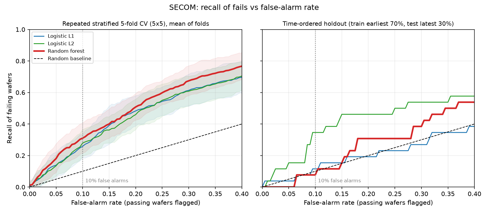
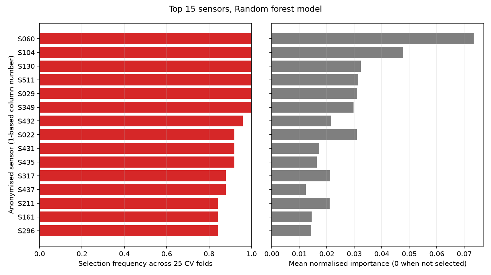
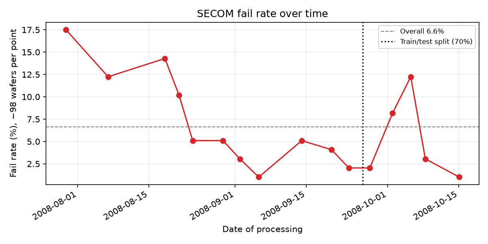

# secom-yield-analysis

Build log: [HOW-IT-WAS-BUILT.md](HOW-IT-WAS-BUILT.md) | One-page summary: [WRITEUP.md](WRITEUP.md)

A leakage-safe, reproducible attempt to flag failing wafers from process sensor data, using the public UCI SECOM semiconductor dataset (1,567 wafers, 590 anonymised sensors, 104 fails, base fail rate 6.6%). It reports what works and what does not.

## Headline

**Random forest, repeated stratified 5-fold CV (5x5): 30.7% of failing wafers caught at a 10.0% false-alarm rate** (mean over 25 folds, std 10.2 points; a random flagger would catch 10%). At a 5% false-alarm rate it catches 18.9% (std 7.6).

**That edge does not survive a time-ordered holdout.** Training on the earliest 70% of wafers and testing on the latest 30% (26 fails), the models are close to chance (ROC-AUC 0.492 to 0.619, with wide intervals), and thresholds set on training data caught 0.0% to 3.8% of fails. The holdout headline model is again the random forest (ROC-AUC 0.593, 95% interval 0.466 to 0.705), chosen using training-period wafers only (see below). Wafer processes drift, so the time-ordered result is the one to believe. See the tables below.

## Charts







## Results

All numbers below are copied from `results/metrics.json`. Fail = positive class. Base rate of fails: 6.6% (whole data), 5.5% (time-holdout test period).

### Repeated stratified 5-fold CV (5x5, seed 42)

Mean (std) across 25 folds. "Recall @ 10% FPR" uses a threshold chosen on the training part only (out-of-fold training scores), applied unchanged to the test fold; the realised false-alarm rate on the test fold is shown next to it. "ROC-curve recall" is read off each test fold's ROC curve at FPR <= 10%; its threshold is chosen with the test labels, so it is not directly comparable with the train-threshold figure, whose realised FPR varies from fold to fold.

| Model | ROC-AUC | PR-AUC (base rate 0.066) | Recall @ 10% FPR (train threshold) | Realised FPR | ROC-curve recall @ 10% | Recall @ 5% FPR (train threshold) | Realised FPR |
|---|---|---|---|---|---|---|---|
| Logistic L1 | 0.694 (0.047) | 0.157 (0.033) | 28.9% (8.9) | 10.9% (2.2) | 25.8% (7.5) | 17.2% (8.2) | 6.2% (1.9) |
| Logistic L2 | 0.699 (0.046) | 0.158 (0.035) | 27.9% (7.4) | 10.4% (2.0) | 27.9% (8.6) | 14.7% (7.2) | 5.5% (1.0) |
| Random forest | 0.736 (0.040) | 0.183 (0.048) | 30.7% (10.2) | 10.0% (1.8) | 31.0% (9.6) | 18.9% (7.6) | 5.2% (1.2) |

For these CV results the random forest is the headline model because it has the highest mean ROC-AUC of the three in this 5x5 CV over all 1,567 wafers; all three are reported. The std is the spread across fold results. Folds from different repeats overlap, so it is not an independent standard error.

### Time-ordered holdout (train earliest 1,097 wafers with 78 fails, test latest 470 wafers with 26 fails)

One split, so no std. ROC-AUC has a 95% bootstrap interval over the test wafers.

| Model | ROC-AUC (95% CI) | PR-AUC (base rate 0.055) | Recall @ 10% FPR (train threshold) | Realised FPR | ROC-curve recall @ 10% | ROC-curve recall @ 5% |
|---|---|---|---|---|---|---|
| Logistic L1 | 0.492 (0.372 to 0.606) | 0.069 | 0.0% | 0.2% | 11.5% | 3.8% |
| Logistic L2 | 0.619 (0.487 to 0.750) | 0.117 | 3.8% | 0.7% | 34.6% | 15.4% |
| Random forest | 0.593 (0.466 to 0.705) | 0.071 | 0.0% | 1.1% | 7.7% | 0.0% |

Holdout headline model: the random forest, selected as the model with the highest mean ROC-AUC (0.748, against 0.702 for L1 and 0.674 for L2) in a 5x5 CV run on the earliest 1,097 wafers only, so no test-period label influenced the choice. This is separate from the CV headline above, which was chosen on all wafers.

With 26 test fails, one fail is 3.8 percentage points. The 34.6% for logistic L2 is a ROC-curve recall on one split (threshold chosen with test labels) and I would not lean on it: the same model's training-based threshold caught 3.8%, and the other two models are near the random line. Scores from the training period were not on the same scale as scores in the test period (realised false-alarm rates of 0.2% to 1.1% across the three models against a 10% target), which suggests the score distribution shifted between periods.

### Top-10 sensors

Two honest versions of "only 10 sensors":

- **In-fold top-10** (feature selection fixed to k=10 inside every fold or in the training period):

| Model | CV ROC-AUC | CV recall @ 10% FPR (train threshold) | CV realised FPR | Time-holdout ROC-AUC |
|---|---|---|---|---|
| Logistic L1 | 0.702 | 31.8% | 11.3% | 0.492 |
| Logistic L2 | 0.708 | 29.6% | 11.3% | 0.681 |
| Random forest | 0.706 | 27.5% | 9.4% | 0.594 |

- **Ten sensors fixed from the training period only** (ranked by selection frequency over a 5x3 CV of the earliest 70%), then tested on the latest 30%: ROC-AUC 0.573 (L1), 0.572 (L2), 0.593 (random forest); train-threshold recall 0.0% for all three.

Reading: in cross-validation, 10 sensors do about as well as the tuned 20-to-60-sensor models (for the random forest, 27.5% of fails at a 9.4% realised false-alarm rate, std 7.6 points). In the time-ordered test, 10 sensors do not catch fails reliably either. I do not claim a working 10-sensor detector.

### Sensor ranking

The ranking in the chart is for the random forest, by how often each sensor was selected across the 25 CV folds and by its mean normalised importance (0 when not selected). S060, S104, S130, S511, S029 and S349 were selected in all 25 folds; S432 in 96% and S022, S431 and S435 in 92%. The full top-15 and the top-10 per model are in `results/metrics.json`. Sensor names are 1-based column numbers; the data carries no sensor names.

## Method

One sklearn `Pipeline`, fitted inside every fold, never on the full data:

1. Column filter: drop columns with more than 50% missing values and constant or near-constant columns (most common value covers more than 99% of observed values).
2. Median imputation.
3. Standard scaling.
4. `SelectKBest` (ANOVA F), with k tuned over {20, 60} (or fixed to 10 for the top-10 runs).
5. Model with `class_weight` for the imbalance: logistic regression with L1 penalty (C in 0.01, 0.1, 1), logistic regression with L2 penalty (C in 0.001, 0.01, 0.1), or a random forest (300 trees, `min_samples_leaf` in 1, 5). SMOTE was not tried.

Evaluation:

- **Primary:** `RepeatedStratifiedKFold`, 5 folds x 5 repeats, seed 42. Inside each outer training part, a 3-fold grid search (ROC-AUC) picks hyperparameters.
- **Thresholds:** for the "train threshold" numbers, the score threshold is the one that gives the target false-alarm rate on out-of-fold scores of the outer training part. It is then applied to the test part, and the realised false-alarm rate is reported. The "ROC-curve recall" columns instead read the test fold's own ROC curve at FPR <= target.
- **Secondary:** wafers sorted by timestamp; the first 70% train (same tuning, same threshold rule), the last 30% test.
- Everything is written to `results/metrics.json` with the seed and package versions.

## Reproduce

```
uv venv && uv pip install -r requirements.txt && .venv/bin/python analysis.py
```

Downloads SECOM from UCI at runtime into `data/` (gitignored; raw data is not committed). On a 16-core machine a full run took 185.4 seconds. Tested with Python 3.12.

## Limits

- Only 104 fails (26 in the time-holdout test), so every estimate is noisy. CV std is 7 to 10 points on recall.
- Sensors are anonymised, so nothing here is a physical interpretation. Adjacent columns (S431, S432, S435, S436, S437) rank together, which probably reflects correlated measurements, not 5 independent causes.
- The data comes from one process over about three months and drifts (the fail rate swings visibly between periods; see the fail-rate chart, and note the train and test periods have different base rates). CV mixes time periods, so it is optimistic. The time-ordered holdout is the honest figure.
- The ROC-curve recall columns choose their threshold with the test labels, so they are not directly comparable with the train-threshold figures, whose realised false-alarm rate varies.
- Hyperparameter grids are small on purpose. A bigger search might move the numbers; I did not test that.
- This is an analysis of a public benchmark. It has not been used in production.

## Dataset and license

McCann, M. and Johnston, A. (2008). SECOM. UCI Machine Learning Repository, https://archive.ics.uci.edu/dataset/179/secom. Licensed CC BY 4.0. Labels: -1 is pass and 1 is fail in the source; here fail is 1 and pass is 0.

The code in this repository is MIT licensed (see `LICENSE`).
